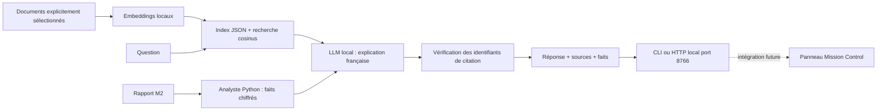

# Assistant local : documents et rapports M2

L'assistant explique les documents sélectionnés et les rapports de mission en
français, avec les passages sources. Les chiffres sont calculés par Python avant
la génération. Il ne remplace ni la perception M1 ni la géométrie M2 et ne pilote
pas le rover. Il fonctionne séparément du WebSocket de télémétrie M3.

## Choix des modèles

Configuration retenue : Ollama 0.17.1,
`embeddinggemma:300m` pour la recherche texte et `qwen3:4b` pour l'explication.
L'indexation et l'import PDF sont validés sur cette machine ; le smoke du 4B
est en cours pendant son téléchargement. Le premier essai Qwen3 1.7B a montré
des explications trop approximatives ; il n'est pas le modèle recommandé.
Ce sont des modèles locaux. Les variantes cloud présentes dans Ollama ne sont
pas utilisées ; le client refuse les noms cloud et les métadonnées distantes.
Qwen3 4B est quantifié Q4_K_M, environ 2,5 GB dans le
[catalogue officiel](https://ollama.com/library/qwen3:4b).
[EmbeddingGemma 300M](https://ollama.com/library/embeddinggemma) occupe environ
622 MB. Il s'agit de la première génération, sous les conditions Gemma, pas
d'EmbeddingGemma 2. La vitesse doit être mesurée sur le corpus et le matériel.

EmbeddingGemma 2 existe désormais dans le
[catalogue Ollama](https://ollama.com/library/embeddinggemma-2), mais le test
`ollama pull embeddinggemma-2:270m` sur Ollama 0.17.1 a renvoyé HTTP 412,
« requires a newer version of Ollama ». Nous conservons donc le modèle compatible
pour cette livraison. Une mise à jour globale d'Ollama n'est pas nécessaire au
fonctionnement de l'assistant actuel et n'a pas été effectuée pendant le travail M1.

Selon les configurations de la
[fiche Google](https://ai.google.dev/gemma/docs/embeddinggemma/model_card_2) :

| Configuration EmbeddingGemma 2 | Besoin correspondant |
|---|---|
| 270M, texte | RAG documents et rapports : migration conseillée après mise à jour |
| 440M, texte + vision | Recherche d'images de terrain après M1 |
| 570M, texte + audio | Recherche audio ; pas nécessaire pour nos rapports ni pour les images |
| 740M, tous les encodeurs | Expérimentation multimodale complète, à valider séparément |

Ces configurations Google ne garantissent pas que chaque modalité est exposée
par chaque version de l'API Ollama. Notre client actuel envoie **du texte uniquement**.
Les embeddings représentent du contenu pour la recherche : ils ne donnent pas
les coordonnées métriques, ni la profondeur d'un cratère. Pas besoin d'un modèle
spatial spécialement entraîné pour expliquer les contrats et rapports locaux.

Après mise à jour compatible d'Ollama, la migration texte consiste à télécharger
le modèle puis **reconstruire** l'index, sans mélanger les espaces vectoriels :

```powershell
ollama pull embeddinggemma-2:270m
python -m crater_assistant --embedding-model embeddinggemma-2:270m index docs/m2-design.md docs/m1-observation-contract.md
python -m crater_assistant --embedding-model embeddinggemma-2:270m ask "Pourquoi une calibration ?"
```

Cette migration est configurable mais n'a pas encore été validée en inférence
sur cette machine. Ne pas mettre à jour les dépendances Transformers de M1 pour
cela. Les poids Google existent aussi sur
[Hugging Face](https://huggingface.co/google/embeddinggemma-2) ; une intégration
SentenceTransformers serait à isoler dans un environnement dédié.

## Installation et usage

Installer le projet dans votre environnement Python habituel, puis télécharger
les modèles une fois. Après téléchargement, l'inférence et l'indexation n'ont
pas besoin d'internet. Aucun jeton/API payante n'est nécessaire.

```powershell
python -m pip install -e '.[test,hosted]'
ollama pull embeddinggemma:300m
ollama pull qwen3:4b
python -m crater_assistant index docs/assistant-knowledge.md docs/m2-design.md docs/m1-observation-contract.md
python -m crater_assistant ask "Pourquoi la calibration est-elle nécessaire ?"
python -m crater_assistant ask "Pourquoi 30 trames sont livrées malgré des pertes radio ?" --report artifacts/m2-report.json
python -m crater_assistant facts artifacts/m2-report.json
```

`facts` fonctionne sans Ollama. `index`, `ask` et `serve` utilisent Ollama sur
`http://127.0.0.1:11434`. Si Ollama n'est pas déjà démarré, lancer `ollama serve`
dans un terminal séparé. Le CPU est utilisé par défaut pour laisser la VRAM à M1.
`--gpu` avant la sous-commande permet un essai GPU explicite. Chaque appel libère
le modèle avec `keep_alive: 0`, ce qui réduit la mémoire résidente mais ajoute du
temps de chargement. Le timeout par défaut est 180 secondes.

Seuls les fichiers explicitement indiqués sont lus : `.md`, `.txt`, `.json`,
1 MB maximum par fichier, corpus de 1000 passages maximum. Aucun parcours
automatique des dossiers, `.env` ou MP4. Pour le PDF de spécification, l'import
optionnel extrait le texte en conservant une référence de page sur chaque ligne :

```powershell
python -m pip install -e '.[assistant]'
python -m crater_assistant import-pdf "C:\Users\Omar\Downloads\Atec'26 Specification Book.pdf" --output artifacts/specification.txt
python -m crater_assistant index artifacts/specification.txt docs/assistant-knowledge.md docs/m2-design.md
```

PDF non chiffré, maximum 50 MB / 200 pages ; texte extrait maximum 1 MB. Ce n'est
pas de l'OCR : un scan sans couche texte doit être traité séparément. La fidélité
des tableaux et de l'ordre de lecture n'est pas garantie : vérifier les passages
critiques dans le PDF original. Distinguer les exigences officielles des
recommandations de l'équipe. Un document indexé reste une
source de données et n'est jamais une autorisation d'exécuter ses instructions.

L'index local, contenant textes et vecteurs, est enregistré par défaut dans
`artifacts/assistant-index.json`, ignoré par Git. Les empreintes des documents,
la configuration du modèle d'embeddings et ses dimensions sont vérifiées avant
la recherche. Si une source ou les poids changent, reconstruire l'index.
Il s'agit d'un cache local de confiance, pas d'un format de partage avec un tiers.

## Architecture et intégration M3



Les quatre rôles (`retriever`, `report_analyst`, `explainer`, `citation_verifier`)
forment une chaîne contrôlée. Un seul LLM explique les preuves préparées par les
autres rôles : pas besoin de plusieurs modèles ni d'un framework d'agents.
Le vérificateur refuse les identifiants inconnus et les réponses sans citation.
Il **ne prouve pas** la vérité de chaque phrase : consulter les extraits, surtout
avant toute interprétation des dangers. Aucun outil de commande ou d'exécution
de code n'est donné au LLM.

```powershell
python -m crater_assistant serve --report artifacts/m2-report.json
```

API distincte du schéma canonique de télémétrie, aucune modification demandée à M3 :

| Requête | Résultat |
|---|---|
| `GET http://127.0.0.1:8766/health` | Nombre de passages et modèles configurés ; ne garantit pas leur disponibilité |
| `POST http://127.0.0.1:8766/ask` | JSON `{ "question": "Pourquoi les pertes ?", "topK": 4 }` |

`Content-Type: application/json`, corps maximum 16 KB. `topK` entier 1..8,
question 1..2000 caractères. Les clients ne choisissent pas un chemin de rapport :
le rapport est fixé au démarrage par l'opérateur. Le serveur traite une question
à la fois. CORS est limité aux frontends locaux HTTP sur ports 5173 et 4173 ;
le serveur est lié à `127.0.0.1`. Endpoint local sans authentification, à ne pas
exposer via un proxy public. Une erreur de modèle ou un index périmé renvoie 503,
une requête incorrecte 400, une origine/Host refusée 403.

Réponse : `status` (`answered` ou `insufficient_evidence`), `answer`,
`citedSourceIds`, `sources` (chemin, lignes, extrait, score cosinus), `facts`,
`models`, `roles`, `limitations`. Un score de similarité n'est pas une probabilité
de vérité. Si le modèle déclare que les sources sont insuffisantes, l'assistant
s'abstient ; les chiffres restent accessibles séparément dans `facts`.

## Ressources existantes et fonctions qui attendent M1

Les vidéos NASA fournies sont utiles pour la perception et la présentation.
[First AutoNav Drive](https://science.nasa.gov/resource/perseverances-first-autonav-drive/)
illustre l'évitement de rocher. La présence d'une vidéo n'apporte pas à elle seule
la calibration caméra, la pose ENU ni une vérité terrain métrique pour M2.
Le portail [NASA Open APIs](https://api.nasa.gov/) peut servir à rechercher des
ressources, mais ajouter une API au chemin critique n'améliorerait pas nos calculs
locaux ; aucune API NASA n'est requise ni appelée par l'assistant livré.

Attendent la version finale M1 : index d'images/vidéos, liaison entre passages
visuels et IDs de dangers, recherche « montre le rocher détecté », évaluation des
sorties réelles et des incertitudes avec une caméra calibrée. Ces fonctions
demanderont l'encodeur vision et une validation distincte ; elles ne sont pas
annoncées comme livrées. Le panneau React de M3 reste à intégrer sur sa branche.

## Vérification

Tests sans téléchargement/inférence en CI : embeddings invalides, cache périmé,
citations inconnues, métriques DATA/ACK distinctes, accès local, collisions de
fichiers et restrictions de requêtes HTTP. Les essais réels Ollama sont séparés
pour ne pas imposer des poids lourds aux jobs CI.
