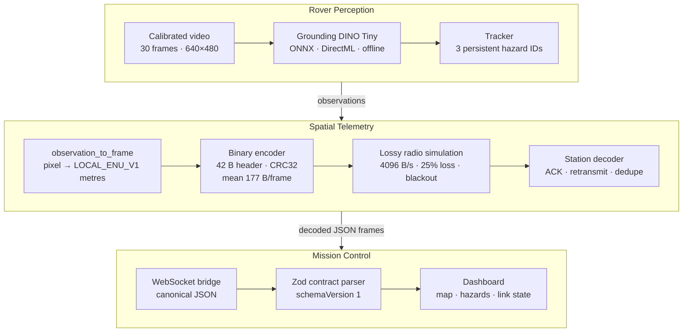
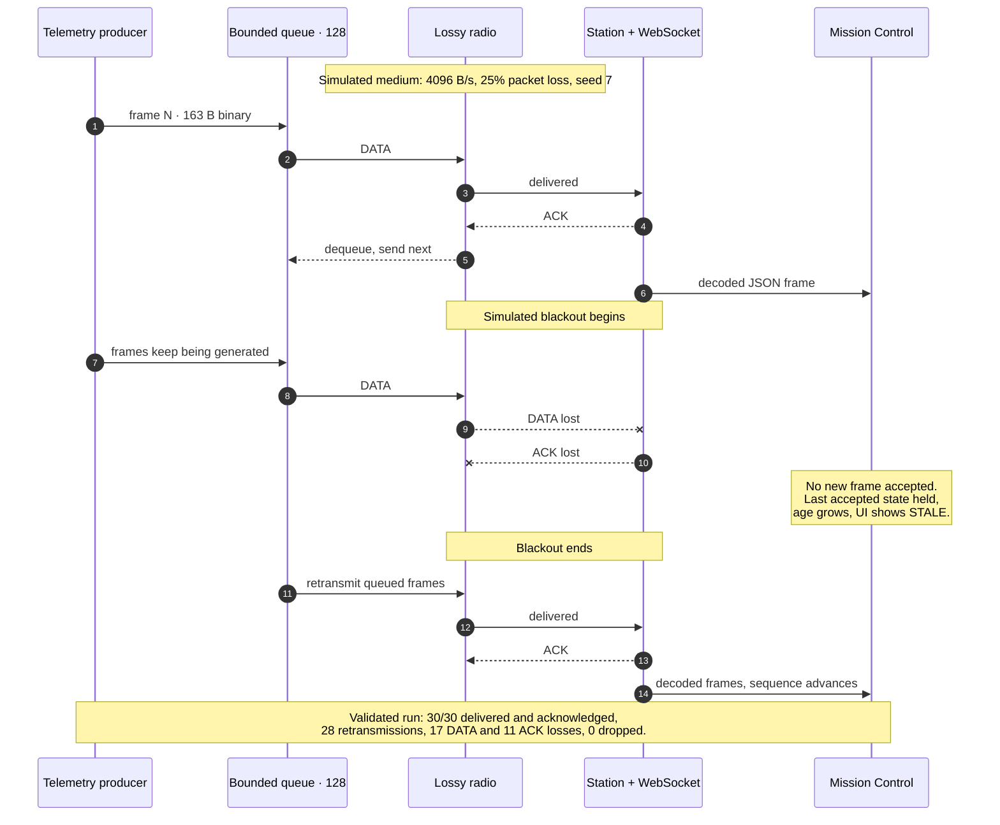
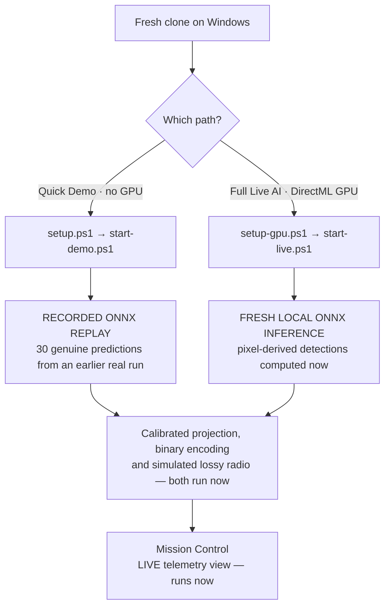

<div align="center">


# C.R.A.T.E.R.

**Lunar hazard reconnaissance — from rover camera to Mission Control**



<sub>**ROVER DETECTS → RADIO BLACKOUT → INCIDENT RECORDED → ROBOT ASKS AI → POST-CAPTURE AI ANALYSIS → MISSION CONTROL DISPLAYS THE ANSWER.** The dialogue is automatic, text-based and event-driven. Generation runs **after** capture, never during live perception, and never issues a rover command. Motion-free variant: [`crater-hero-static.svg`](docs/brand/crater-hero-static.svg).</sub>

[](https://github.com/omarfh111/C.R.A.T.E.R/actions/workflows/m1-tests.yml) [](https://github.com/omarfh111/C.R.A.T.E.R/actions/workflows/m2-tests.yml) [](https://github.com/omarfh111/C.R.A.T.E.R/actions/workflows/mission-control-ci.yml) [](LICENSE)

</div>

C.R.A.T.E.R. runs object detection **locally in the emulated rover pipeline**, turns each detection into a metric position in a local East-North-Up frame, and ships it to Mission Control in **binary frames averaging 177 bytes** that survive packet loss and a radio blackout.

---

## Start Here

**Windows prerequisites:** PowerShell, Python 3.12+, Node.js 24+ with npm, and a browser.

```powershell
git clone https://github.com/omarfh111/C.R.A.T.E.R.git
cd C.R.A.T.E.R
```

**Quick Demo (recommended; no GPU, model download, secrets, or AI service):**

```powershell
.\scripts\setup.ps1
.\scripts\start-demo.ps1
```

**Full Live AI Demo (optional; compatible Windows DirectML GPU):**

```powershell
.\scripts\setup-gpu.ps1
.\scripts\start-live.ps1
```

The launcher opens Mission Control and prints its local `http://127.0.0.1:<port>/` URL. Each run uses fresh loopback ports to keep older tabs from triggering capture. If Windows blocks scripts, run `Set-ExecutionPolicy -Scope Process Bypass` in that PowerShell window, then retry; this does not change the permanent policy.

### What is real in each path

| | Quick Demo | Full Live AI |
|---|---|---|
| Detections | **Recorded ONNX replay** — 30 predictions from an earlier real ONNX run | **Fresh local ONNX inference** from the committed calibrated video |
| Detector | — | Grounding DINO Tiny ONNX on DirectML |
| Spatial projection, binary encoding, radio | Runs now | Runs now |
| Mission Control dashboard | Runs now, LIVE telemetry view | Runs now, LIVE telemetry view |
| GPU required | No | Yes |

**Radio loss and blackout are simulated.** Original capture times stay historical, so replayed frames can legitimately show as STALE in the dashboard. Spatial accuracy figures below come from a **controlled synthetic calibrated scene only** — they are not a lunar object-detection benchmark. First-time GPU setup may require substantial downloads.

---

## Why this matters

**Continuous raw-video transmission is costly over a constrained space communication link.** Every stage of C.R.A.T.E.R. exists because the link is the scarce resource, not the compute.

- **Detection stays in the emulated rover pipeline.** Grounding DINO Tiny runs locally through ONNX Runtime and DirectML, offline from a pinned model cache. No cloud, no API key, no network at inference time.
- **Hazards leave as geometry, not pixels.** Each detected ground-contact point is projected through known camera intrinsics and pose into `LOCAL_ENU_V1` metres with an uncertainty radius — so Mission Control receives a position it can act on, not a bounding box it must re-interpret.
- **The wire format is budgeted.** A rover pose with three hazards encodes to exactly 163 bytes; across the validated run binary frames averaged 177 bytes against 1,001 bytes of equivalent JSON. Every DATA packet, retransmission and ACK together came to 35.7% of the original JSON byte count.
- **Degradation is designed for, not hidden.** Frames queue in a bounded queue, retransmit after lost ACKs, and arrive out of their original wall-clock window. Mission Control holds its last accepted state, marks its age STALE, and rejects anything that fails the contract — rather than showing nothing, or showing something it cannot vouch for.

---

## The pipeline

| Stage | Module | What it does | Evidence |
|---|---|---|---|
| Capture | Rover Perception | 30-frame, 640×480 calibrated scene with camera intrinsics and per-frame pose | SHA-256 pinned in [manifest.json](examples/m1-onnx-calibrated/manifest.json) |
| Detect | Rover Perception | Grounding DINO Tiny ONNX via DirectML, offline from a pinned revision | 90 pixel-derived detections over 30 frames |
| Track | Rover Perception | Persistent hazard identity across frames | 3 track IDs, 0 ID switches |
| Project | Spatial Telemetry | `observation_to_frame` maps the detected ground-contact pixel into `LOCAL_ENU_V1` | 0.097 m mean error on 90 matches |
| Encode | Spatial Telemetry | 42-byte big-endian header, per-hazard records, CRC32 | [binary protocol v1](docs/m2-binary-protocol.md) |
| Transmit | Spatial Telemetry | Byte-budgeted lossy radio simulation with ACK and retransmission | 30/30 delivered and acknowledged |
| Visualise | Mission Control | WebSocket bridge, Zod contract validation, Mission Control dashboard | [telemetry contract v1](docs/telemetry-contract.md) |

Detection, calculated geometry, simulated communications and dashboard visualisation are deliberately separate concerns: **only the first is AI**, and the radio is a simulator, not hardware.

---

## Architecture

### End-to-end data path

Detection and tracking run in the emulated rover pipeline; only encoded geometry crosses the radio.



### Radio blackout and recovery



### The two judge paths



---

## Measured validation evidence

All figures below come from [integration validation](docs/integration-validation.md) and [perception validation](docs/m1-final-validation.md). They describe one controlled scene on one validated Windows host, not a general benchmark.

### Detection and tracking — controlled synthetic scene

| Metric | Value |
|---|---|
| Frames processed | 30 |
| Genuine ONNX detections | 90, across 3 tracked rocks |
| True positives / false positives / misses | 90 / 0 / 0 |
| Mean IoU | 0.814 |
| ID switches | 0 |
| Processing throughput | 3.94 FPS (mean inference 235.85 ms, p95 pipeline 307.43 ms) |

### Spatial localisation — controlled synthetic scene

Each detected box was matched to an annotation and its **detected** ground-contact pixel projected by the spatial telemetry module. Ground-truth boxes were never used as projection input.

| Metric | All 90 matches | 45 held-out matches |
|---|---|---|
| Mean error | **0.097 m** | 0.094 m |
| Median | 0.082 m | 0.086 m |
| p95 | 0.193 m | 0.182 m |
| Maximum | 0.213 m | 0.203 m |
| Within reported uncertainty radius | 90 / 90 | 45 / 45 |

### Radio and transport — validated lossy scenario

4,096 B/s budget, 25% packet loss, simulated blackout, bounded queue of 128, 20 attempts, seed 7.

| Metric | Value |
|---|---|
| Generated / delivered / acknowledged | 30 / 30 / 30 |
| Retransmissions | 28 |
| Lost DATA / lost ACK packets | 17 / 11 |
| Dropped / abandoned / rejected | 0 / 0 / 0 |
| Mean binary frame | 177 B (vs 1,001 B JSON) |
| Total radio application bytes | 10,717 — **35.7%** of the original JSON bytes |

Byte accounting covers DATA and ACK payloads only; lower network layers are excluded. All 30 received WebSocket frames equalled the decoded telemetry frames and passed the integrated Mission Control Zod parser.

### Test status

| Suite | Result |
|---|---|
| Python (full, local) | 246 passed, 5 skipped |
| Mission Control frontend | 39 passed, 1 opt-in smoke skipped by default |
| TypeScript production build | Passed (bundle-size warning) |

Hosted CI runs portable, model-free checks and does not load the ONNX graph.

---

## Technology stack

| Layer | Technology |
|---|---|
| Perception | Python, ONNX Runtime 1.24.4 (DirectML + CPU providers), `onnx-community/grounding-dino-tiny-ONNX` at revision `ff690b0a` |
| Spatial and transport | Python, pinhole projection on a known ground plane, custom big-endian binary protocol with CRC32, byte-budgeted lossy radio simulator |
| Bridge | Local WebSocket station publishing canonical JSON in `LOCAL_ENU_V1` |
| Mission Control | React, TypeScript, Vite, Tailwind, Zod schema validation |
| Validation | pytest, Vitest, GitHub Actions (perception, telemetry and Mission Control workflows) |

---

## Documentation

**Demo and launch**

- [Windows setup and launch guide](docs/end-to-end-integration.md)
- [Seven-minute live demonstration](docs/seven-minute-demo.md)
- [Measured validation evidence](docs/integration-validation.md)

**Engineering contracts**

The three modules are labelled M1, M2 and M3 throughout the codebase, commit history and CI:

- **Rover Perception** (M1) — `crater_m1/`, [perception contract](docs/m1-contract.md), [observation contract](docs/m1-observation-contract.md), [calibrated ONNX validation](docs/m1-final-validation.md)
- **Spatial Telemetry** (M2) — `crater_m2/`, [spatial and radio guide](M2_README.md), [binary protocol v1](docs/m2-binary-protocol.md), [ONNX callback integration](docs/m1-m2-onnx-integration.md), [calibrated handoff](docs/m1-calibrated-handoff.md)
- **Mission Control** (M3) — `src/`, [telemetry contract v1](docs/telemetry-contract.md), `src/telemetry/contract.ts`
- Evidence — [ONNX evidence bundle](examples/m1-onnx-calibrated/README.md)
- Optional local assistant — [ASSISTANT_README.md](ASSISTANT_README.md)
- Brand assets — [docs/brand/](docs/brand/)

---

## Development checks

Use the setup scripts above for a fresh clone. The Python test suite does not download model weights; hardware validation is a separate local run.

```powershell
& .\.venv\Scripts\python.exe -m pip install -e '.[test,hosted,spaces]'
& .\.venv\Scripts\python.exe -m pytest -q
npm test
npm run build
```

The launchers configure an ignored `.env.local` for LIVE telemetry and print the selected local URL. For manual development, the telemetry station defaults to `ws://127.0.0.1:8765/telemetry`; copy `.env.example` to `.env.local` and set `VITE_TELEMETRY_MODE=LIVE` before running `npm run dev`. The frontend defaults to deterministic MOCK mode until LIVE is selected.

---

## Limitations and reproducibility

**What this project demonstrates:** a functional local synthetic-scene demonstration and a validated perception → telemetry → Mission Control contract. Nothing here has been field-validated on lunar imagery.

- Spatial accuracy is specific to the controlled calibrated scene. The projection assumes known calibration and a flat ground plane. **No accuracy claim is made for uncalibrated NASA footage or real lunar terrain**, and detector confidence is not a calibrated probability.
- The NASA videos lack matching calibration, and their available annotations do not match the supplied video hashes. They remain perception-only evidence.
- Radio loss, blackout and link degradation are **simulated** by the telemetry module. A station WebSocket disconnection does not establish a rover radio blackout.
- Stale age is measured from capture time, so historical observation replay can legitimately remain stale. Restart a browser telemetry session when telemetry sequence numbering restarts, or use an increasing `--start-sequence`.
- The cinematic lunar introduction and the dashboard map are local assets drawn from accepted `LOCAL_ENU_V1` coordinates. They are **not** surveyed lunar imagery.
- Exact detector-input rerun requires the local MP4 and the prepared ONNX cache, which stay outside Git. The tracked [evidence bundle](examples/m1-onnx-calibrated/README.md) supports independent hash checks and transport replay; reproducing identical predictions across different hardware is not guaranteed.

---

<div align="center">


Licensed under the [Apache License 2.0](LICENSE).

</div>
