# Exécuter M1 → M2 → contrat M3 sur le PC M1

M2 inclut exactement les sources M1 du commit `45cbf2f`. Le lanceur sélectionne
`onnx-grounding-dino` et DirectML sans changer le modèle, le tracker ou les
sources M1. Sur le PC d'Omar, aucun poids ONNX n'a été téléchargé. Les essais
locaux utilisent des fixtures et le détecteur `synthetic-contrast` **explicitement**
pour vérifier les interfaces, pas pour annoncer des performances ONNX.

## Préparer les checkouts sans modifier la branche M1

Sur le PC du développeur M1, ces étapes de préparation peuvent utiliser internet.
Si les dossiers existent déjà, réutiliser les checkouts appropriés plutôt que
rejouer `worktree add`. Le Python et les poids restent ceux de son environnement.

```powershell
git -C D:\space_esb_m1 fetch origin feat/spatial-telemetry feat/mission-control
git -C D:\space_esb_m1 worktree add --detach D:\space_esb_m2 origin/feat/spatial-telemetry
git -C D:\space_esb_m1 worktree add --detach D:\space_esb_m3 2015192b51ed1b4485faff1fa48bff5442cb3c82
Set-Location D:\space_esb_m3
npm ci --ignore-scripts --no-audit --no-fund
Set-Location D:\space_esb_m2
$m1Python = 'D:\space_esb_m1\.venv\Scripts\python.exe'
& $m1Python -m pip install 'websockets>=15,<16'
$m3Contract = 'D:\space_esb_m3\src\telemetry\contract.ts'
```

Node >=22.18 est nécessaire ; Node 24 convient. Le checkout M3 ci-dessus fixe
le contrat déjà convenu. Les autres fonctionnalités du dashboard peuvent rester
sur sa branche. Aucune modification ni installation éditable de M1 n'est demandée.
Exécuter les commandes Python **depuis D:\space_esb_m2** pour utiliser le code
M2 et le snapshot M1 intégré. Les tests n'appellent aucun service cloud.

## Artefacts attendus de M1

- Vidéo non recadrée, déjà rectifiée, et résolution cohérente avec la calibration.
- Calibration JSON : `frameId: LOCAL_ENU_V1`, `ground_z_m` en mètres et `frames`.
  Chaque clé de `frames` est l'indice original de l'image, même avec `--stride`.
  Chaque pose fournit `camera`, `roverPositionEnuM`, `positionUncertaintyRadiusM`.
- Caméra : `width`, `height`, `fx`, `fy`, `cx`, `cy`, `centerEnuM`,
  `rotationCameraToEnu` orthonormale et de déterminant +1.
- Origine partagée avec M3 : marqueur de départ ; x Est, y Nord, z Haut.
- Plan de sol connu : ce modèle localise un contact au sol, pas la profondeur
  d'un cratère ni la hauteur d'un rocher. Incertitude pixel + budget de pose,
  pas une borne certifiée pour un terrain inconnu.
- `observations.jsonl` issues des véritables prédictions ONNX, avec poses par trame.
- Chemin du cache ONNX réellement préparé, à confirmer par M1.

Les vidéos NASA sans poses fiables ne permettent pas cette validation métrique.
Une pose absente, une résolution incohérente ou un repère incompatible échoue
explicitement ; aucune localisation synthétique n'est substituée.

## 1. Relecture JSONL avant le modèle continu

Remplacer le chemin ci-dessous par le fichier calibré validé transmis par M1.
Choisir un nouveau répertoire de validation à chaque essai.

```powershell
$observations = 'D:\space_esb_m1\outputs\calibrated-demo\observations.jsonl'
$calibration = 'D:\space_esb_m1\outputs\calibrated-demo\calibration.json'
$groundZ = (Get-Content -Raw $calibration | ConvertFrom-Json).ground_z_m
if ($null -eq $groundZ) { throw 'Définir explicitement ground_z_m dans la calibration validée.' }
& $m1Python -m crater_m2.validation --output outputs/replay-onnx-01 --m3-contract $m3Contract -- --input $observations --input-ground-z $groundZ --duration 90 --drain 180 --fps 4 --bandwidth 4096 --loss .25 --blackout 3:6 --queue 128 --attempts 20
```

`--fps` règle uniquement la cadence de relecture, pas les timestamps d'origine.
La capture WebSocket doit correspondre exactement aux trames décodées et au
compteur de livraisons. Chaque message est validé avec le véritable parser M3.
Le JSONL brut M1 ne contient pas la hauteur du sol : `--input-ground-z` fournit
le plan connu de sa calibration. M2 sauvegarde aussi `perception/m2-observations.jsonl`
en mode continu, enrichi avec `groundZM` ; sa relecture conserve directement
le plan sans cette option. Le fichier M1 original reste inchangé.

## 2. Callback continu avec les véritables poids ONNX

Définir les trois chemins réels fournis par M1, après validation de sa séquence.
Le cache ci-dessous est un exemple, pas un emplacement confirmé.

```powershell
$onnxCache = 'D:\space_esb_m1\.cache\huggingface'
$video = 'D:\space_esb_m1\outputs\calibrated-demo\scene.mp4'
$calibration = 'D:\space_esb_m1\outputs\calibrated-demo\calibration.json'
$env:HF_HUB_OFFLINE = '1'
$env:TRANSFORMERS_OFFLINE = '1'
$env:HF_HUB_DISABLE_TELEMETRY = '1'
& $m1Python -m crater_m2.validation --output outputs/live-onnx-01 --m3-contract $m3Contract -- --perception-video $video --calibration $calibration --perception-backend onnx-grounding-dino --device directml --cache-dir $onnxCache --no-preview --perception-buffer 4 --duration 90 --drain 180 --fps 10 --bandwidth 4096 --loss .25 --blackout 3:6 --queue 128 --attempts 20
```

Le modèle est chargé uniquement depuis le cache ; DirectML absent ou poids
manquants provoquent un échec. Aucun repli vers `synthetic-contrast` ni inférence
cloud. Les opérateurs non supportés par DirectML peuvent s'exécuter sur CPU,
comme dans M1. `--fps 10` limite la consommation des observations par M2 ;
ce n'est pas une promesse d'inférence à 10 FPS. La fenêtre inclut le chargement
du modèle ; augmenter la durée si le run doit traiter toute la vidéo.

`--confirmed-only` est optionnel : il retarde l'export des nouvelles pistes.
Le seuil .25 et le filtre `edges` reprennent M1. `--tiles 2x2` conserve ses
recadrages internes remappés aux pixels originaux, avec un coût d'inférence accru.

## Résultats et critères

Le validateur exporte `m2-report.json`, `decoded.jsonl`, `websocket.jsonl`,
`arrivals.jsonl`, `validation.json`, les logs et le répertoire `perception/`
pour le mode continu. Il refuse un répertoire déjà utilisé. Le process enfant
hérite des variables offline. Le seul socket requis est le WebSocket loopback.
La capture attend la connexion du validateur avant de commencer la mission
(`--wait-for-client 30`), pour ne manquer aucune première livraison.

Vérifier `canonicalM3Validated`, `socketMatchesDecodedFrames`, les séquences,
`delivered/acknowledged`, `pending`, `queueDropped`, `abandoned`, les pertes
DATA/ACK, `retransmissions`, `radioDuplicates`, `maxPending` et les latences.
Les captures pendant la coupure portent un statut déconnecté puis sont livrées
après récupération. Une file pleine ou une coupure trop longue peut provoquer
des pertes définitives : des réessais limités ne garantissent pas toute mission.

`source.perceptionMetrics` conserve les métriques originales M1, modèle,
révision, provider et GPU détecté. Les latences M1 incluent l'attente du callback ;
`inference_ms_mean` distingue le coût de détection. Les temps de handoff sont
mesurés séparément. Le maximum de tampon est échantillonné, pas un pic exact.
Si M2 arrête le producteur avant la fin, les métriques finales M1 peuvent être
absentes ; les compteurs de consommation et d'interruption restent explicites.

Le validateur choisit un port libre pour la capture automatique. Pour connecter
le dashboard M3 au port canonique 8765, lancer `python -m crater_m2` avec les mêmes
arguments live et `--port 8765` ; les options de sortie se choisissent alors
manuellement. L'affichage du dashboard doit être vérifié sur le PC M1/M3.

## Preuves obtenues sur le PC M2

Les preuves dans `docs/validation/m1-m2-calibrated-transport.json` couvrent
12 observations JSONL à poses variables puis 12 callbacks réels du pipeline M1
sur une scène générée, avec `synthetic-contrast` explicitement sélectionné.
Tous les messages WebSocket sont acceptés par M3, après coupure, pertes et
récupération. Elles ne constituent **pas** une validation ONNX/RTX 5070.
La séquence calibrée, les véritables prédictions et la performance GPU seront
validées sur le PC M1 avec les commandes ci-dessus.

```mermaid
flowchart LR
    V[Vidéo rectifiée + poses connues par trame] --> M1[Grounding DINO ONNX local + tracking]
    M1 --> Q[Callback et tampon borné]
    Q --> G[M2 rayon calibré / plan de sol connu]
    G --> B[Binaire CRC + file ARQ]
    B --> R[Débit / pertes / coupure / récupération]
    R --> W[JSON canonique WebSocket v1]
    W --> C[Parser M3 + capture de chaque message]
```


