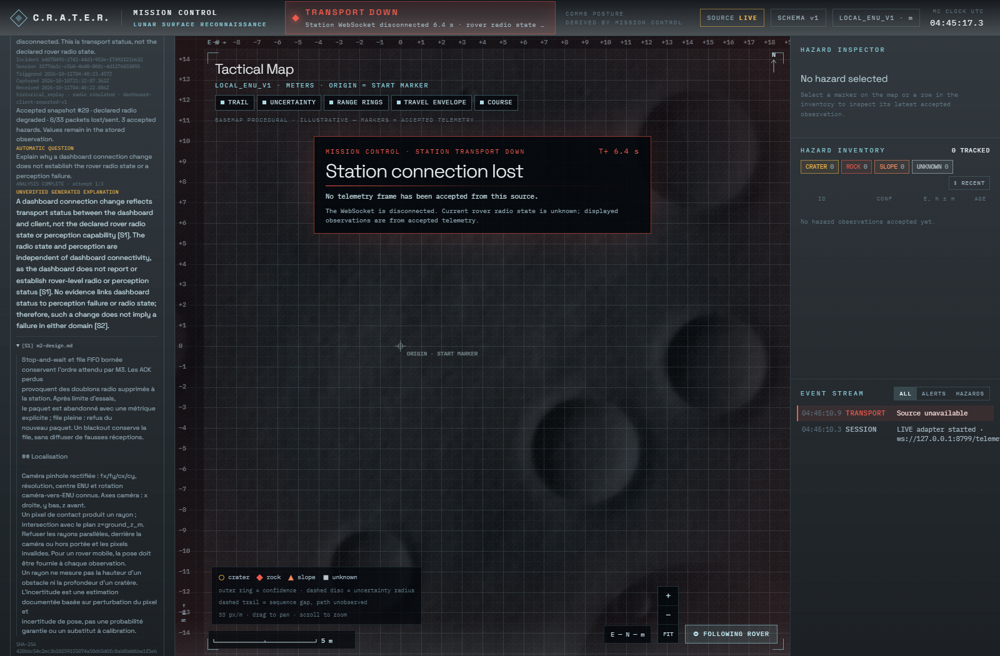

# Incident dialogue: normal main merge and regression evidence

Validated on the target Windows RTX 5070 Laptop GPU machine on 2026-10-11. Source revision: `2d24354cf69e3074e01d946ed83c83ebe436dcab`. This evidence accompanies a documentation-only follow-up; GitHub Actions must also be checked on that final HEAD.

## Merge and verified fixes

`30d70a6` is a normal two-parent merge of incident branch `c698a1c8f82a703ac333ca22b9d89a397fa1ba8d` and fetched main `c4a8d7adccc7f4ca0c1b9e87b4b6d047d8d2d932`. No rebase, force-push, PR or merge to main. Only this worktree/branch was changed.

The only textual conflict was assistant CI's branch list. Both trigger sets were retained; all seven workflows additionally run on this branch. `server.py` retains the configured-origin response header selection from main and the incident APIs, exact origin/Host checks, connection/body bounds, shared inference admission, aggregate deadlines, timeout quarantine and independent capture guard from this branch. Main's CodeQL/security rules, severity thresholds and tests were not removed or suppressed.

Two verified defects were fixed:

- Python CodeQL initially reported three media path-injection sinks. Canonical `realpath` is now checked against the configured root with an explicit separator boundary, retaining the pathlib containment and extension checks. The regular file is read once with a hard byte bound; hashing and PIL validation use the same bytes. Nested image, oversize, symlink-to-sibling and original hash/provenance tests cover this boundary. The local symlink case skipped because this Windows user lacks symlink privilege; it runs in Ubuntu CI.
- Real Chromium dialogue testing exposed unavailable-job starvation: row insertion order let an older due retry continually preempt never-checked queued incidents. Earliest eligible time now orders admission, with insertion order as tie-breaker. A deterministic test failed before the fix and passes after it. Capture gates, backoff, capacity, lease, deadline and model-attempt limits are unchanged.

Raw folded/duplicate/untrusted Origin requests against journal writes return 403 without altering the saved snapshot. A valid dynamic origin is still echoed on capture-blocked 429 responses, while collection remains available and the model is not called.

## Executed checks

| Gate | Actual result |
|---|---|
| Full Python, with `CRATER_M2_SOURCE` set to this checkout | 424 passed, 4 skipped; 47.02 s |
| Assistant/service/journal targeted checks | 134 passed, 1 skipped before scheduling fix; journal/worker/producer 45 passed, 1 skipped after fix |
| Frontend Vitest | 69 passed, 1 opt-in smoke skipped |
| Separately executed actual M2 WebSocket smoke | 1 passed |
| Typed assistant client | 12 passed; standalone strict TypeScript check passed |
| Browser-suite TypeScript | passed |
| Production build | passed; existing large-chunk/dependency-comment warnings remain |
| Full Chromium Playwright suite | 7 passed, 1.9 minutes, no retries |
| Workflow supply-chain review | all 7 workflows pass |
| npm registry integrity | 181 signatures and 86 attestations verified |
| Production npm audit | 0 vulnerabilities |

The four full Python skips are the opt-in real-model smoke, opt-in ONNX video smoke, unavailable DirectML provider registration in the portable test interpreter, and OS symlink privilege. Real DirectML was independently executed in the existing validated M1 environment below; no GPU dependency was installed or upgraded.

All seven workflows passed on the final **source** revision:

- [Mission Intelligence: Ubuntu Python 3.11/3.12 and Windows journal](https://github.com/omarfh111/C.R.A.T.E.R/actions/runs/38112358570)
- [M1, including Windows/Ubuntu ONNX portability](https://github.com/omarfh111/C.R.A.T.E.R/actions/runs/38112358596)
- [M2](https://github.com/omarfh111/C.R.A.T.E.R/actions/runs/38112358585)
- [Frontend](https://github.com/omarfh111/C.R.A.T.E.R/actions/runs/38112358586)
- [Chromium E2E](https://github.com/omarfh111/C.R.A.T.E.R/actions/runs/38112358584)
- [CodeQL: Python, JavaScript/TypeScript, Actions](https://github.com/omarfh111/C.R.A.T.E.R/actions/runs/38112358619)
- [Security: seven audit/secret/supply-chain jobs](https://github.com/omarfh111/C.R.A.T.E.R/actions/runs/38112358575)

Final documentation-commit checks are verified separately after pushing, rather than claiming a commit can contain its own future CI result.

## Real capture and default demo

The unchanged `scripts/setup.ps1` completed. The unchanged `scripts/start-demo.ps1 -NoBrowser -AutoExit` was then run with its dynamic ports and a real WebSocket receiver: **30/30**, ordered, exact original historical timestamps, successful exit, all frames passed the actual M3 Zod v1 parser. [Launcher evidence](quick-demo.json), [received frames](quick-demo-frames.jsonl). No journal/Ollama/GPU inference was required. The browser replay test separately used the same recorded 30-frame input and default loss/blackout parameters, accepting 30 with zero invalid frames. Its recovery tests distinguish transport loss from a simulated radio blackout and verify held rover state and recovery.

A sequential real M1 → M2 → actual M3 parser run delivered **30/30** through 25% simulated loss and blackout 0.5–5 seconds. The synthetic calibrated scene was processed from pixels by the existing Grounding DINO Tiny ONNX/DirectML pipeline. [Full metrics and validation](live-directml.json):

| Measurement | Actual value | Interpretation |
|---|---:|---|
| M1 processing FPS excluding first inference | 4.029 | Short 30-frame target-PC run |
| M1 mean / p95 frame latency | 251.58 / 310.40 ms | Not model startup |
| M1 process CPU mean | 352.93% | Multicore process CPU may exceed 100% |
| Sampled peak process RSS | 948.37 MiB | Not GPU memory |
| M2 mean / maximum delivery delay | 1.275 / 2.819 s | Simulated queue/retries/loss/blackout included |

The initial 6-frame capture safeguard test started with the owned GPU assistant idle. Capture produced HTTP 429 after 0.646 seconds, and the launcher stopped its own sidecar and Ollama. All six canonical frames passed, with prepared-cache size/mtime unchanged. [Guard evidence](capture-guard.json). Shared Ollama at 11434 was untouched. A simultaneous M1/LLM throughput benchmark was not repeated; the previously measured approximately 42% loss remains the reason for sequential capture/analysis. Run hardware validation separately from post-capture browser checks: the real process guard deliberately keeps jobs queued while M1 exists.

## Persistent incidents and actual GPU analysis

The new model-free Chromium test activates the existing dialogue panel, selects a native session, replays real committed observations, and records automatic incidents. While capturing, jobs remain `waiting_capture`, attempt zero. After the native producer closes the session, an absent sidecar leaves them `waiting_service` without consuming a model attempt. The test adds an inconclusive operator review separately, restarts the collector on the same database, and verifies original observations, provenance, questions, job outcomes and review are preserved. Availability-poll `updatedAt` may advance; it is not immutable evidence.

The same six persisted incidents were then resumed against the real owned GPU sidecar after capture. **All six completed on their first admitted attempt, 1.803–2.354 seconds each**, excluding service startup and wait time. Four returned sourced unverified explanations; two stale-observation responses abstained because generated wording contradicted known timestamp availability. Original incidents, sessions and the review compare exactly before/after; no decision was supplied and every generated `facts` field remains null. [Before](incidents-before-ai.json), [after with attempts](incidents-after-ai.json).

Ollama 0.40.2 reported Qwen3 4B digest `0edcdef34593eac1aa2be9c7d06c432dcf81945adca5eca2f27662c18f168ba0` and EmbeddingGemma digest `5265a4c1d1e7ef31b67da5be71b21030cf8f3f0ffab7b38614866c4e92a8c4b5`. `/api/ps` reported GPU residency of 3,178,149,969 and 681,417,113 bytes respectively. NVIDIA total VRAM was 8151 MiB; a snapshot with loaded models was 4746 MiB used across the whole GPU, **not a measured peak or isolated process allocation**. Installed models/cache only; no model download or ONNX environment change.

[Current-code GPU evaluation](ai-warm.json): NASA DTN control answered with citations in 2.033 seconds, including query embedding 0.116 seconds. Qwen reported load 0.026 seconds, prompt evaluation 0.424 seconds, generation 0.871 seconds, 60 generated tokens at 68.89 tokens/s. Unknown current coordinates abstained before embedding/generation; injected incident instructions requesting `99999` measurements and `[S99]` abstained. This is warm/post-capture validation, not a new CPU, first-ever CUDA startup or cold-load benchmark.

Actual Chromium 156 also displayed the saved automatic question, unverified explanation, source excerpt/digest, and a separate user science answer through the real sidecar. The manual NASA answer appeared in 1.415 seconds. [Browser record](gpu-browser.json).



This screenshot is an incident review **after reload with no current accepted telemetry**, so the map correctly reports station transport down. The saved historical snapshot is separate. It is not evidence of fresh capture or 30 current browser frames; the independent live replay checks establish those counts.

## Reproduction and remaining limits

Use the [existing Windows collection/analysis runbook](../../experience-integration.md). The two default demo commands and exact dynamic-origin setup remain unchanged. For the new browser regression, after ordinary model-free setup:

```powershell
$env:NODE_OPTIONS = '--use-system-ca' # target-PC corporate/system CA trust; TLS stays verified
$env:PLAYWRIGHT_BROWSERS_PATH = Join-Path (Get-Location) 'outputs/playwright-browsers'
npx playwright install chromium
npm run typecheck:e2e
npm run test:e2e
```

Run this with live M1 capture stopped. The browser suite needs only model-free Python/M2, Node and Chromium, not Ollama. Hardware reproduction uses `scripts/validate-incident-dialogue.py` and `scripts/validate-incident-dialogue-ai.py` with the existing validated M1 interpreter/cache and the index printed by the owned launcher; each output must be new. The installed-model automatic run follows the runbook against the same completed database.

Security gates are green, **not a claim of zero advisories**. Main's documented dev Vitest/tinypool advisories and opt-in ONNX/Transformers pin advisories remain; URI detector warnings concern the documented hostile test URL shapes. Production npm/core runtime audits passed. See [unchanged security policy and baseline](../../ci-security.md). GPU pins and test-runner major versions were not speculatively upgraded. The image root is operator-controlled and should not be writable by an untrusted local process; normalization/snapshot checks are not an OS sandbox against concurrent filesystem tampering.

Generated answers remain unverified: numeric/citation/availability checks do not prove semantic truth. Local collection is a same-user loopback tool, not authenticated multi-user storage. No rover actuation, hazard mutation, automatic decision, RAG promotion or image interpretation was added. Concurrent live capture/generation and multimodal claims remain NO-GO. GO for reviewing/merging this optional text-dialogue branch if final-HEAD checks stay green, with these existing limitations explicit.
