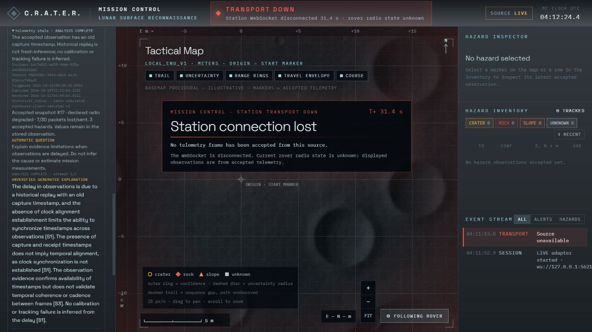

# Incident dialogue — target-PC evidence

Validation date: 2026-10-11. Base main: `1d38cade9a8408e30141d92e8ec23e158836654c`. Isolated branch: `codex/mission-incident-dialogue`, checkout `D:\space_esb_mission_dialogue`. Pinned design reference: M2 `57b2943`. No README, other worktree, shared Ollama, DirectML environment/model cache, canonical contract/codec or radio changes were made.

## What was executed

- Fresh model-free `scripts/setup.ps1`, then unchanged `scripts/start-demo.ps1 -NoBrowser`: all 30 historical ONNX frames delivered with 25% simulated loss, blackout 0.5–5 seconds and recovery. Actual browser packet accounting showed ACCEPTED 30, INVALID/DUPLICATE/OUT-OF-ORDER/SEQ GAPS all zero. Original timestamps remained historical. Assistant was absent for this default demo. See [report](quick-demo.json).
- Real Grounding DINO Tiny ONNX FP32 + DirectML, existing validated M1 Python/cache, 30 actual pixel-inference frames from the synthetic calibrated clip → M2 binary/radio path → WebSocket → actual M3 Zod v1 parser. 30/30 WebSocket frames matched decoded frames and passed the canonical parser, with 25% simulated loss and blackout/recovery. See [full result](live-directml.json).
- Six additional real DirectML frames with the optional AI initially idle: active capture returned HTTP 429 at approximately 0.766 seconds; the owned launcher then stopped its own sidecar/Ollama. The guard run validated all six frames and confirmed prepared-cache size/mtime unchanged. See [guard result](capture-guard.json). This is a sequencing check, not a new concurrent-throughput benchmark.
- Final browser dialogue capture: historical replay, 25% simulated loss and blackout 2–10 seconds, [30 canonical frames](replay-frames.jsonl), [M2 report](replay.json). The browser again accepted 30 with no invalid, duplicate, out-of-order or sequence gaps. Journal/model controls remained optional. Five incidents were persisted while the model was off; the UI showed waiting for capture and then waiting for local AI.
- After explicit native completion and owned AI startup, all five jobs completed on attempt one: three sourced unverified explanations and two abstentions. No mission decision was supplied, generated facts were null, and accepted hazards were unchanged. A technical `inconclusive` review was explicitly entered through the actual browser and stored separately. Collector stop/restart preserved the five incidents, five attempts and review exactly, without re-running inference. Source excerpts/digests, unavailable collector, reconnection and persisted results were inspected in the browser. [Incident/attempt/review evidence](incidents.json), [summary](summary.json).

## Separate measured budgets

| Measurement | Actual result | Scope |
|---|---:|---|
| M1 processing FPS excluding first inference | 3.199 | 30-frame synthetic calibrated video, real ONNX/DirectML |
| M1 end-to-end FPS | 3.015 | This short run |
| M1 frame latency mean / p95 | 329.25 / 567.24 ms | Inference, tracking and serialization; model loading excluded |
| M1 inference mean | 253.10 ms | DirectML supported operators; CPU fallback possible |
| M1 process CPU mean / sampled peak RSS | 329.36% / 974.99 MiB | Multicore CPU can exceed 100%; RSS sampled per frame |
| M2 mean / max delivery delay | 1.041 / 2.631 s | Simulated radio capture-to-delivery, queue/retries/blackout included |
| Post-capture automatic analysis | 2.028–2.333 s | Five real sidecar requests, startup/preload excluded |
| Warm NASA question end-to-end | 1.453 s | Embedding + retrieval + generation + checks |
| Warm query embedding wall time | 0.093 s | EmbeddingGemma query |
| Warm Qwen load / prompt evaluation / generation | 0.018 / 0.226 / 0.815 s | Ollama-reported values |
| Warm generation throughput | 73.64 tokens/s | 60 generated tokens |
| First question after idle model unload | 6.502 s | Qwen load 2.127 s; not first CUDA kernel initialization |

Receipt minus historical capture time is **not network latency**. The published M2 delay includes simulated radio behavior; no pure WebSocket wire-latency measurement is claimed. Model startup/index/preload and waiting for service are outside per-attempt analysis time. CPU inference, first-ever CUDA startup, peak GPU memory and simultaneous M1 generation were not remeasured here. The prior main coexistence study reported approximately 42% lower M1 throughput during concurrent generation; [that historical evidence](../mission-intelligence/coexistence.json) remains the reason to enforce sequential capture/analysis.

## Real installed models and adversarial checks

Ollama 0.40.2, NVIDIA RTX 5070 Laptop GPU, 8151 MiB total. Qwen digest `0edcdef34593eac1aa2be9c7d06c432dcf81945adca5eca2f27662c18f168ba0`; EmbeddingGemma digest `5265a4c1d1e7ef31b67da5be71b21030cf8f3f0ffab7b38614866c4e92a8c4b5`. `/api/ps` reported GPU residency of 3,178,149,969 bytes for Qwen and 681,417,113 bytes for EmbeddingGemma, with context 4096 and output budget 240. Total NVIDIA VRAM snapshots are recorded in the JSON; they are not isolated process usage or measured peaks. No models or GPU packages were installed.

The [final current-code evaluation](ai-warm.json) contains a sourced NASA DTN answer and actual load/prompt/generation counters. An unknown current-coordinate question abstained before embedding/generation; injected context asking for invented `99999` measurements and `[S99]` was rejected. A saved stale incident's answer was conservatively rejected for a timestamp contradiction. The [idle-reload sample](ai-reload.json) records the separate longer reload cost on the preceding code revision; measured values are retained and its generic residency label is clarified.

Earlier validation generated an incorrect/ambiguous missing-timestamp explanation. It stayed unverified in local test history with a separate inconclusive technical review; it was not deleted or promoted. Explicit availability flags and two regression cases now reject the observed formulations. The final browser session uses these flags. A further guard rejects tested claims of image interpretation: only local references exist, no vision inference. Regex, numeric presence and citation identity are conservative checks, **not semantic truth certification**. A plausible cited explanation can still be wrong or misattribute context. The UI therefore labels every generated explanation unverified and preserves the original observation separately.

## Executed engineering gates

- Python: **404 passed, 5 skipped**, latest full run 40.22 seconds. Opt-in/environment-specific skips are reported, not counted as passes.
- Frontend: **69 passed, 1 skipped** (the opt-in M2 smoke), plus **one separately executed actual M2 WebSocket smoke pass**.
- Typed assistant client: **12 passed**, strict standalone TypeScript check passed.
- Production frontend build passed. Existing large-bundle warning remains; no dependency was added.
- Production `npm audit --omit=dev --audit-level=high`: **zero vulnerabilities** using Node's system CA support. Initial default CA lookup failed; TLS verification was kept enabled.
- Journal tests exercise UUID conflicts/deduplication, queue saturation preserving incidents, bounded retries/expiry, lease/restart/interruption, cancellation audit, producer authority/lifecycle, malformed/oversized/drip responses, host/redirect/origin rejection, exact v1 snapshots, image path/hash validation, fabricated numbers/citations, and observation contradictions. Existing index/source integrity tests remain in the full suite.
- Dedicated assistant CI was extended to main, feat/** and codex/**; Ubuntu Python 3.11/3.12 run the full model-free gates plus real model-free WebSocket regression, and Windows Python 3.13 runs journal/worker/producer checks. [Verified final source run](https://github.com/omarfh111/C.R.A.T.E.R/actions/runs/38111051945); the final branch run is checked separately after the evidence commit.

## Browser proof and limits



This screenshot is a **stored incident review after dashboard reload**, so the live map has no current accepted frame. The 30/30 browser packet counts were inspected before reload; they are not inferred from the screenshot. The saved incident independently contains its accepted snapshot, original timestamps and provenance. Source expansion and the separately persisted review were verified through the actual UI.

Automatic browser incident collection requires activation and a selected native session; closing the page stops those frontend-derived triggers. Native producer warnings remain independent. Latest-20 global listing and bounded browser/native queues can omit display or collection under overload; the runbook specifies capacities and explicit export/retry behavior. This is a same-user loopback tool, not an authenticated or encrypted journal service. The capture process guard is conservative and best-effort; operator sequencing remains mandatory.

No rover actuation, accepted-hazard mutation, auto-promotion into RAG, diagnosis from missing frames, automatic image capture/association or multimodal interpretation was added. Vision and producer-specific tracking diagnostics remain deferred. GO for reviewing this optional text-dialogue change; concurrent live capture/generation and multimodal claims remain NO-GO.

## Validated atomic source commits

Every commit was reviewed, relevant checks run, then pushed individually with a one-line Conventional Commit message and no body/trailer:

```text
58ee917 feat(experience): persist bounded incidents with explicit provenance
894cd28 feat(experience): analyze incidents through the guarded post-capture worker
2bb8ccf feat(experience): record producer capture lifecycle and actual warnings
4b05218 feat(mission-control): add persistent automatic incident dialogue
6e2e1cf fix(experience): preserve timestamp evidence and bound worker responses
dcc8ee2 fix(mission-control): isolate capture sessions and rate-limit warnings
ede7b12 fix(experience): bound event retries across completed captures
8a148be ci(experience): validate incident dialogue on main and feature branches
5035dc9 fix(experience): abstain on ambiguous timestamp availability claims
a003706 fix(mission-control): distinguish completed capture from session mismatch
ae5b0d3 fix(experience): reject unsupported incident image interpretation
```

The evidence/runbook commit follows these source commits. See [operating commands and recovery](../../experience-integration.md).
